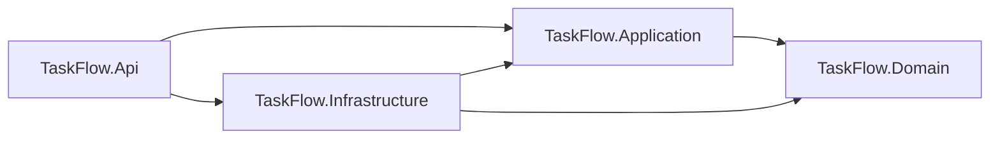
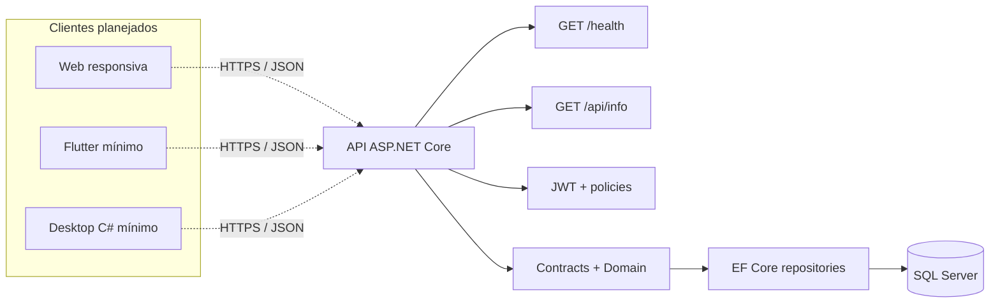

# Arquitetura — TaskFlow

Atualizada em 10/11/2026. A solução adota um monólito modular simples em ASP.NET Core/.NET 10. Uma API compartilhada concentra autenticação, autorização e coordenação das operações. Não há microserviços, CQRS, MediatR ou camadas adicionais.

## Responsabilidades e dependências

| Projeto | Responsabilidade | Dependências de projeto permitidas | Estado atual |
| --- | --- | --- | --- |
| TaskFlow.Domain | Entidades Usuario, Tarefa e HistoricoTarefa, enums e invariantes locais | Nenhuma das outras camadas | Modelo e validações |
| TaskFlow.Application | Contratos de repositório, unidade de trabalho e informações da aplicação | Domain | Contratos e informações |
| TaskFlow.Infrastructure | Persistência SQL Server com EF Core, migrations e repositórios | Application, Domain | Persistência real implementada |
| TaskFlow.Api | Rotas REST, JWT, autorização, contratos HTTP, DI e bootstrap explícito | Application, Infrastructure | Health/info, login, usuários, criação, lista/detalhe/histórico autorizados |
| TaskFlow.Tests | Testes de domínio, middleware HTTP e persistência SQL Server real isolada | Projetos sob teste | Testes automatizados |

As referências da solução expressam a direção das dependências de compilação. A API é o ponto de composição; repositórios e unidade de trabalho são registrados por DI. Não há repositório genérico nem banco em memória para simular persistência.

## Comunicação em execução

`/health` verifica que o processo HTTP responde; não atesta disponibilidade de banco. Em cada requisição com JWT, a API valida assinatura, issuer, audience e expiração e recarrega o usuário do SQL Server para aplicar o perfil atual, não o perfil antigo que esteja no token.

O cliente envia o JWT no cabeçalho Bearer; a API valida identidade e policy antes de executar a rota. Web, mobile e desktop não duplicam autorização e não acessam o banco diretamente.

## Decisões de implementação

- Usar tipos `Guid` para identificadores, enums explícitos e datas UTC. O modelo SQL é detalhado em [modelo de dados](modelo-dados.md).
- Manter a regra de título e validação de enums no domínio. E-mail único e existência de usuários/tarefas dependem de constraints e verificações de persistência.
- `PasswordHash` é gerado/verificado por `PasswordHasher<Usuario>` do ASP.NET Core Identity; sucesso com necessidade de rehash atualiza o valor armazenado. DTOs públicos nunca incluem o hash.
- JWT HMAC-SHA256 usa chave Base64 externa com mínimo de 256 bits, issuer/audience obrigatórios e validade de 60 minutos. Ausência ou chave inválida impede a inicialização; não há valor padrão inseguro.
- Policies ASP.NET Core protegem `/api/users` com o perfil Administrador. Login tem rate limit de 10 tentativas por minuto por IP. `/health` e `/api/info` permanecem públicos.
- `POST /api/tasks` exige policy Administrador; o criador é extraído do claim `sub` validado, nunca do DTO. Responsável opcional precisa ser usuário existente com perfil Funcionario. `GET /api/tasks/{id}` permite consulta a administradores e a usuários que sejam criador ou responsável.
- DTOs de tarefa são separados das entidades; a resposta converte RowVersion binária em Base64. A criação persiste tarefa e evento `CriarTarefa` dentro da mesma `IUnitOfWork` transacional.
- `GET /api/tasks/{id}/history` aplica a mesma regra de vínculo do detalhe e retorna DTOs paginados. A consulta SQL usa `AsNoTracking`, ordena por `DataUtc` e `Id`, conta e materializa apenas a página; a rota não expõe escrita ou exclusão de histórico.
- `GET /api/tasks` constrói no repositório uma consulta SQL `AsNoTracking`. O escopo do funcionário (`CriadorId == usuário || ResponsavelId == usuário`) é aplicado antes dos filtros, contagem e página; o administrador não recebe filtro de escopo. Status, prioridade, responsável, sem responsável e título são combinados por AND. A ordenação descendente por `CriadaEmUtc` e `Id` é determinística. A API obtém identidade e perfil corrente do principal validado, nunca de parâmetros do cliente.
- US01–US05 foram revisadas ao fechar a Sprint 1; critérios, testes e a pendência de demonstração manual estão registrados no [backlog](backlog.md) e [diário](diario-desenvolvimento.md).
- O bootstrap do primeiro administrador é comando local `--bootstrap-admin`, somente em Development e somente para `TaskFlowDev`; pede senha sem eco, é idempotente e nunca roda no startup.
- Atualização de usuário usa transação serializável para preservar o último administrador. Não existe endpoint de remoção.
- `PATCH /api/tasks/{id}/status` aceita somente status e RowVersion Base64; o administrador pode alterar qualquer tarefa, enquanto o funcionário deve ser o responsável atual (ser apenas criador não autoriza a alteração).
- `PUT /api/tasks/{id}` é exclusivo de administrador e aceita campos parciais de título, descrição, prioridade, prazo e responsável. Descrição, prazo e responsável podem ser removidos com `null`; o endpoint rejeita `status`, que é exclusivo do PATCH.
- O RowVersion recebido é validado como exatamente oito bytes, comparado ao token lido e aplicado novamente à entidade como token original antes do `UpdateAsync`. O mapeamento do backing field `_rowVersion` continua associado à coluna SQL `Versao`; a cláusula de concorrência do EF Core usa o token original no `UPDATE`. `DbUpdateConcurrencyException` retorna 409, preservando a gravação concorrente.
- Cada evento de alteração efetiva registra ação, usuário autenticado, tarefa e data UTC; alterações compostas e seus eventos são salvos no mesmo `IUnitOfWork` transacional. Operações sem mudança não alteram RowVersion nem geram evento; descrições de auditoria não copiam texto livre nem IDs de responsável. A aplicação é a única origem do histórico, sem triggers duplicadores.
- EF Core migrations são a única fonte oficial do schema. `database/scripts/001_schema.sql` é referência técnica do Dia 1 e não foi executado.
- Carregar configuração não sensível por `appsettings`; connection strings e chave de assinatura vêm de configuração externa/User Secrets, sem valores reais no repositório.
- Expor Swagger apenas em desenvolvimento. A implantação futura deverá configurar HTTPS, observabilidade mínima e verificações de disponibilidade conforme as dependências reais.

## Evolução prevista

As migrations existentes são a única estratégia oficial de evolução do schema. Os Dias 4 a 7 não alteraram schema nem executaram migration; criação/histórico, paginação, listagem, edição, concorrência e permissões foram validados em bancos isolados. O fluxo manual de bootstrap e a demonstração em `TaskFlowDev` ainda requerem credenciais escolhidas pelo mantenedor.

Docker, Kubernetes, CI/CD e clientes web/mobile/desktop pertencem às próximas sprints; os diretórios reservados não representam infraestrutura implantada. Resultados medidos estão em [ambiente](ambiente.md) e [diário](diario-desenvolvimento.md).
