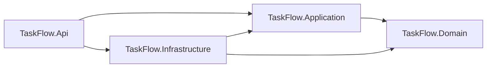
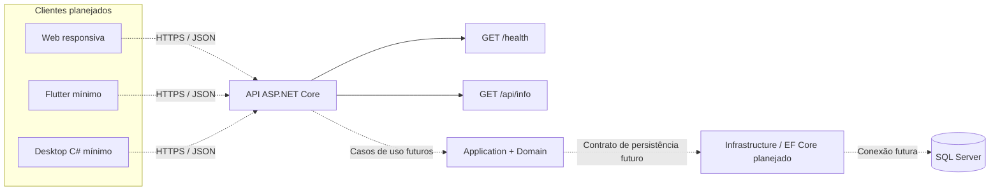

# Arquitetura — TaskFlow

Referência: 09/11/2026. A solução adota um monólito modular simples em ASP.NET Core/.NET 8. Uma API compartilhada concentra regras de acesso e coordenação das operações. Não há necessidade de microserviços, CQRS, MediatR ou camadas adicionais para o escopo de duas semanas.

O SDK 8 está disponível e foi mantido conforme a preferência do projeto. Seu suporte termina em **10/11/2026**, durante a janela planejada; no Dia 2, reavaliar a atualização para .NET 10, já instalado, antes da implantação. A decisão deve incluir compatibilidade dos pacotes e nova execução dos testes. Fonte: [política oficial de suporte .NET](https://dotnet.microsoft.com/en-us/platform/support/policy/dotnet-core).

## Responsabilidades e dependências

| Projeto | Responsabilidade | Dependências de projeto permitidas | Situação no Dia 1 |
| --- | --- | --- | --- |
| TaskFlow.Domain | Entidades Usuario, Tarefa e HistoricoTarefa, enums e invariantes locais | Nenhuma das outras camadas | Modelo e validações |
| TaskFlow.Application | Casos de uso e contratos exigidos por esses casos; informações da aplicação | Domain | Informações do sistema; casos de tarefas futuros |
| TaskFlow.Infrastructure | Implementações de persistência e integrações | Application, Domain | Projeto reservado para persistência futura |
| TaskFlow.Api | Rotas REST, composição de DI, contratos HTTP e futura autenticação/autorização | Application, Infrastructure | `/health`, `/api/info` e Swagger em desenvolvimento |
| TaskFlow.Tests | Testes das regras e contratos implementados | Projetos sob teste | Testes básicos; resultados no diário |

As referências da solução expressam a direção das dependências de compilação. A API é o ponto de composição; quando existirem contratos de persistência na Application, suas implementações serão registradas por DI. O Dia 1 não cria repositórios genéricos, serviços sem uso ou uma implementação de banco em memória para simular persistência.

## Comunicação em execução

Setas contínuas no segundo diagrama representam a superfície mínima do Dia 1; setas pontilhadas representam integração planejada. Os projetos Application e Infrastructure já integram a solução, mas não há consulta ao SQL Server na inicialização nem nos dois endpoints atuais. `/health` verifica que o processo HTTP responde; ainda não atesta disponibilidade de banco ou prontidão de integrações.

No fluxo futuro, o cliente envia uma requisição com credencial e versão quando exigidas; a API valida identidade e contrato; o caso de uso verifica permissões e aciona as regras de domínio; Infrastructure executa a persistência. A API retorna o resultado real ou um erro HTTP adequado. Web, mobile e desktop não duplicam a autorização e não acessam o banco diretamente.

## Decisões de implementação

- Usar tipos `Guid` para identificadores, enums explícitos e datas UTC. O modelo SQL é detalhado em [modelo de dados](modelo-dados.md).
- Manter a regra de título e validação de enums no domínio. E-mail único e existência de usuários/tarefas dependem de constraints e verificações de persistência.
- Manter `PasswordHash` exclusivamente para um hash gerado por um componente de autenticação apropriado. A entidade não implementa login e não demonstra segurança de senha por validar apenas uma string.
- Planejar autorização no servidor conforme a [matriz de permissões](escopo.md). Nenhuma rota de negócio será exposta antes de implementar os controles necessários.
- Planejar concorrência otimista com `rowversion` de oito bytes, emitido pelo SQL Server. O caso de uso futuro deverá informar conflito HTTP 409 ao tentar persistir uma versão antiga; o Dia 1 não simula esse fluxo.
- Persistir alterações relevantes de tarefa e histórico na mesma transação. O mecanismo de auditoria será definido antes da implementação SQL complementar, evitando duplicar registros entre aplicação e trigger.
- Adotar uma única fonte oficial para o schema, preferencialmente EF Core migrations. `database/scripts/001_schema.sql` é referência técnica do Dia 1; não executar esse script e migrations concorrentes sobre o mesmo banco.
- Carregar configuração não sensível por `appsettings`; credenciais futuras virão de configuração externa ou armazenamento de segredos, sem valores reais no repositório.
- Expor Swagger apenas em desenvolvimento. A implantação futura deverá configurar HTTPS, observabilidade mínima e verificações de disponibilidade conforme as dependências reais.

## Evolução prevista

No Dia 2, reavaliar a versão .NET, confirmar estratégia de schema, implementar mapeamentos EF Core e uma primeira migration revisada, preparar conexão local sem versionar segredos e testar constraints/concorrência em SQL Server real. Em seguida, implementar os casos de uso e autenticação, preservando dependências existentes.

Docker, Kubernetes e CI/CD pertencem às próximas sprints; os diretórios reservados não representam infraestrutura implantada. A validação do Dia 1 está em [ambiente](ambiente.md) e [diário](diario-desenvolvimento.md); não se presume execução a partir da existência dos arquivos.
