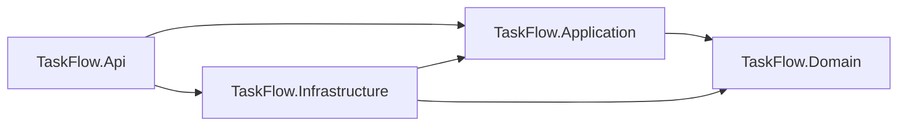
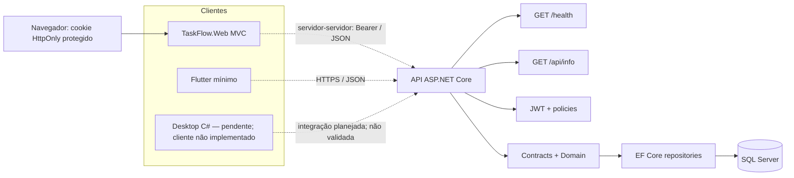

# Arquitetura — TaskFlow

Atualizada em 10/11/2026. A solução adota um monólito modular simples em ASP.NET Core/.NET 10. Uma API compartilhada concentra autenticação, autorização e coordenação das operações. Não há microserviços, CQRS, MediatR ou camadas adicionais.

## Responsabilidades e dependências

| Projeto | Responsabilidade | Dependências de projeto permitidas | Estado atual |
| --- | --- | --- | --- |
| TaskFlow.Domain | Entidades Usuario, Tarefa e HistoricoTarefa, enums e invariantes locais | Nenhuma das outras camadas | Modelo e validações |
| TaskFlow.Application | Contratos de repositório, unidade de trabalho e informações da aplicação | Domain | Contratos e informações |
| TaskFlow.Infrastructure | Persistência SQL Server com EF Core, migrations e repositórios | Application, Domain | Persistência real implementada |
| TaskFlow.Api | Rotas REST, JWT, autorização, contratos HTTP, DI e bootstrap explícito | Application, Infrastructure | Health/info, login, usuários, criação, lista/detalhe/histórico autorizados |
| TaskFlow.Web | Interface ASP.NET Core MVC, autenticação por cookie e cliente HTTP tipado para a API | Nenhum projeto de domínio; contratos HTTP locais | Painel, tarefas, histórico e administração de usuários |
| TaskFlow.Tests | Testes de domínio, middleware HTTP e persistência SQL Server real isolada | Projetos sob teste | Testes automatizados |

As referências da solução expressam a direção das dependências de compilação. A API é o ponto de composição; repositórios e unidade de trabalho são registrados por DI. Não há repositório genérico nem banco em memória para simular persistência.

## Comunicação em execução

## Inicialização do banco de demonstração

A API não cria nem aplica migrations automaticamente. Para preparar `TaskFlowDemo`, a connection string local deve apontar explicitamente para esse catálogo e o mantenedor aplica as migrations com `dotnet ef database update` antes de iniciar o serviço. O comando usa o catálogo configurado e pode criar ou atualizar o schema; portanto, confirme o destino e o histórico antes da execução.

O seeder da conta de demonstração roda somente em ambiente `Development`, com `DemoAdmin:Enabled=true`, após confirmar conexão disponível e catálogo exatamente `TaskFlowDemo`. Nome, e-mail e senha válidos são fornecidos por configuração local. A criação e o hash da senha ocorrem em transação serializável. Ele cria a conta quando ausente, não altera administrador existente e interrompe a inicialização se o e-mail já pertencer a usuário não administrador. O comando `--bootstrap-admin` é separado, interativo e restrito a `TaskFlowDev`; não serve para criar a conta em `TaskFlowDemo`.

`/health` verifica que o processo HTTP responde; não atesta disponibilidade de banco. Em cada requisição com JWT, a API valida assinatura, issuer, audience e expiração e recarrega o usuário do SQL Server para aplicar o perfil atual, não o perfil antigo que esteja no token.

O cliente envia o JWT no cabeçalho Bearer; a API valida identidade e policy antes de executar a rota. Web, mobile e desktop não duplicam autorização e não acessam o banco diretamente.

`TaskFlow.Web` mantém o JWT somente no ticket de autenticação protegido pelo ASP.NET Core Data Protection. O navegador recebe cookie de autenticação `HttpOnly`; chamadas Bearer para a API ocorrem servidor-servidor por `HttpClient` tipado. O cookie é `Secure` em produção, com expiração limitada à expiração do token; em Development usa HTTP local. A aplicação rejeita `Api:BaseUrl` em HTTP fora de Development para não enviar Bearer em texto claro. Formulários POST usam antiforgery e perfis administrativos são conferidos na interface, sem substituir a autorização e revalidação de perfil da API.

Em cada requisição autenticada, `TaskFlowClaimsTransformation` consulta `GET /api/auth/me` e reconstrói os claims gerenciados (ID, nome, e-mail, perfil e token), removendo cópias anteriores. Se a API falhar ou não retornar um usuário, a identidade retornada não carrega autorização administrativa; em 401 a transformação também encerra o cookie protegido. A validação acontece antes das políticas MVC, evita chamadas ao próprio middleware/rotas MVC e não substitui a autorização da API, que também carrega o perfil corrente do banco. A sessão guarda o token protegido no servidor; não há token em HTML ou JavaScript.

O CSS local compartilha variáveis de tema escuro em `src/TaskFlow.Web/wwwroot/css/site.css`; as interações são CSS/JavaScript nativos, sem dependência de UI. A implementação respeita `prefers-reduced-motion` e mantém navegação móvel com suporte a teclado.

## Decisões de implementação

- Usar tipos `Guid` para identificadores, enums explícitos e datas UTC. O modelo SQL é detalhado em [modelo de dados](modelo-dados.md).
- Manter a regra de título e validação de enums no domínio. E-mail único e existência de usuários/tarefas dependem de constraints e verificações de persistência.
- `PasswordHash` é gerado/verificado por `PasswordHasher<Usuario>` do ASP.NET Core Identity; sucesso com necessidade de rehash atualiza o valor armazenado. DTOs públicos nunca incluem o hash.
- JWT HMAC-SHA256 usa chave Base64 externa com mínimo de 256 bits, issuer/audience obrigatórios e validade de 60 minutos. Ausência ou chave inválida impede a inicialização; não há valor padrão inseguro.
- Policies ASP.NET Core protegem `/api/users` com o perfil Administrador. Login tem rate limit de 10 tentativas por minuto por IP. `/health` e `/api/info` permanecem públicos.
- `POST /api/tasks` exige policy Administrador; o criador é extraído do claim `sub` validado, nunca do DTO. Responsável opcional precisa ser usuário existente com perfil Funcionario. `GET /api/tasks/{id}` permite consulta a administradores e a usuários que sejam criador ou responsável.
- DTOs de tarefa são separados das entidades; a resposta converte RowVersion binária em Base64. A criação persiste tarefa e evento `CriarTarefa` dentro da mesma `IUnitOfWork` transacional.
- `GET /api/tasks/{id}/history` aplica a mesma regra de vínculo do detalhe e retorna DTOs paginados. A consulta SQL usa `AsNoTracking`, ordena por `DataUtc` e `Id`, conta e materializa apenas a página; a rota não expõe escrita ou exclusão de histórico.
- `GET /api/tasks` constrói no repositório uma consulta SQL `AsNoTracking`. O escopo do funcionário (`CriadorId == usuário || ResponsavelId == usuário`) é aplicado antes dos filtros, contagem e página; o administrador não recebe filtro de escopo. Status, prioridade, responsável, sem responsável e título são combinados por AND. A ordenação descendente por `CriadaEmUtc` e `Id` é determinística. A API obtém identidade e perfil corrente do principal validado, nunca de parâmetros do cliente.
- US01–US05 foram revisadas ao fechar a Sprint 1; critérios, testes e a pendência de demonstração manual estão registrados no [backlog](backlog.md) e [diário](diario-desenvolvimento.md).
- O bootstrap do primeiro administrador é comando local `--bootstrap-admin`, somente em Development e somente para `TaskFlowDev`; pede senha sem eco, é idempotente e nunca roda no startup.
- Atualização de usuário usa transação serializável para preservar o último administrador. Não existe endpoint de remoção.
- `PATCH /api/tasks/{id}/status` aceita somente status e RowVersion Base64; o administrador pode alterar qualquer tarefa, enquanto o funcionário deve ser o responsável atual (ser apenas criador não autoriza a alteração).
- `PUT /api/tasks/{id}` é exclusivo de administrador e aceita campos parciais de título, descrição, prioridade, prazo e responsável. Descrição, prazo e responsável podem ser removidos com `null`; o endpoint rejeita `status`, que é exclusivo do PATCH.
- O RowVersion recebido é validado como exatamente oito bytes, comparado ao token lido e aplicado novamente à entidade como token original antes do `UpdateAsync`. O mapeamento do backing field `_rowVersion` continua associado à coluna SQL `Versao`; a cláusula de concorrência do EF Core usa o token original no `UPDATE`. `DbUpdateConcurrencyException` retorna 409, preservando a gravação concorrente.
- Cada evento de alteração efetiva registra ação, usuário autenticado, tarefa e data UTC; alterações compostas e seus eventos são salvos no mesmo `IUnitOfWork` transacional. Operações sem mudança não alteram RowVersion nem geram evento; descrições de auditoria não copiam texto livre nem IDs de responsável. A aplicação é a única origem do histórico, sem triggers duplicadores.
- EF Core migrations são a única fonte oficial do schema. `database/scripts/001_schema.sql` é referência técnica do Dia 1 e não foi executado.
- Carregar configuração não sensível por `appsettings`; connection strings e chave de assinatura vêm de configuração externa/User Secrets, sem valores reais no repositório.
- Expor Swagger apenas em desenvolvimento. A implantação futura deverá configurar HTTPS, observabilidade mínima e verificações de disponibilidade conforme as dependências reais.
- O projeto MVC usa DTOs/ViewModels próprios para não introduzir dependência de referência entre Web e camadas da API. URL da API é configuração por ambiente; em produção deve ser HTTPS (enforced pelo startup) e as chaves de Data Protection devem ser persistidas/compartilhadas segundo a topologia de implantação.

## Evolução prevista

As migrations existentes são a única estratégia oficial de evolução do schema. O texto sobre os Dias 4 a 7 é histórico: naquele período, criação/histórico, paginação, listagem, edição, concorrência e permissões foram validados em bancos isolados.

O cliente Flutter e a interface Web estão implementados e integrados à API. Nesta revisão complementar, o Flutter passou build/análise/testes, mas o AVD não iniciou por falta de espaço; a navegação mobile registrada em revisão anterior é evidência histórica. API e MVC foram verificadas localmente. O cliente desktop, Docker, Kubernetes, CI/CD e implantação/monitoramento em nuvem permanecem pendentes; diretórios reservados não representam infraestrutura implantada. Resultados e limites estão em [ambiente](ambiente.md) e [diário](diario-desenvolvimento.md).

## US09 - programabilidade SQL Server e resumo do Dashboard

`dbo.fn_TarefasVisiveis(@UsuarioId)` e uma inline TVF somente-leitura que retorna IDs de tarefas criadas pelo usuario ou atribuidas a ele. O valor GUID vazio nao retorna tarefas; o predicado `OR` evita duplicidade se a pessoa for criadora e responsavel.

`dbo.usp_TarefasResumo(@UsuarioId,@EhAdministrador)` calcula no SQL Server o total, pendentes (status 1), em andamento (2) e concluidas (3). Administradores recebem o resumo global; funcionarios usam a function para limitar o conjunto visivel. A procedure retorna uma linha com zeros quando o conjunto e vazio.

`dbo.TR_Tarefas_ProtegeDadosCriacao` compara `inserted` e `deleted` e rejeita mudanca real de `CriadorId` ou `CriadaEmUtc`, inclusive em updates de varias linhas. Updates normais continuam permitidos; a trigger nao cria historico e nao altera `Versao`.

A migration EF Core `20261113090000_AddTaskFlowProgrammability` cria os tres objetos em batches separados e o Down os remove na ordem trigger, procedure, function. A API expoe `GET /api/tasks/summary`, deriva usuario e perfil dos claims autenticados, e retorna DTO publico. O Dashboard chama esse endpoint e a listagem existente de cinco tarefas recentes em paralelo.

Registro histórico de 13/11/2026: em SQL Server isolado, `SqlServerPersistenceTests` 11/11, `TaskEndpointTests` 32/32, `SqlServerProgrammabilityTests` 2/2 e suíte completa 123/123 passaram. Esses resultados não foram repetidos nesta revisão. Os fixtures históricos criam e removem `TaskFlowIntegrationTests_<GUID>`; a revisão atual não executou esse fluxo.

### Compatibilidade da trigger com EF Core SQL Server

O mapeamento existente de Tarefas chama UseSqlOutputClause(false) no TableBuilder porque a tabela possui trigger DML. A configuracao afeta somente a forma dos comandos gerados pelo provider; Versao continua configurada como rowversion e token de concorrencia. A trigger de imutabilidade permanece habilitada.

## Cliente Desktop (17/11/2026)

`TaskFlow.Desktop` é um cliente WinForms em .NET 10, escolhido por estar disponível no ambiente Windows sem workloads ou dependências adicionais. Mantém DTOs e serviço HTTP próprios, usa JWT somente durante a sessão em memória e delega permissões à API. Implementa login, listagem paginada, detalhe, histórico, alteração de status com RowVersion e tratamento de 400/401/403/404/409. No 409 a interface recarrega a lista/detalhe atual para o usuário revisar. Build e testes HTTP isolados passaram; o fluxo autenticado real não foi exercitado nesta rodada por ausência de API ativa e configuração de credenciais de demonstração.

## Cloud e DevOps (17/11/2026)

Há Dockerfiles multi-stage para API/MVC, Compose de desenvolvimento sem banco embutido, workflow GitHub Actions sem deploy e manifests Kubernetes para Deployments separados, Services internos, Ingress TLS, probes, requests/limits, HPAs e armazenamento compartilhado do key ring Data Protection do MVC. `/health` é liveness de processo; `/ready` verifica conectividade com SQL Server para readiness. API e MVC emitem logs JSON no console. Os manifests referenciam secrets externos e não contêm credenciais.

A arquitetura alvo usa Kubernetes gerenciado, Ingress HTTPS, SQL Server gerenciado em rede privada, secret manager, logs/alertas do provedor, backups/PITR e HPA. É uma proposta, não implantação. Docker, kubectl/cluster, registry, provedor e credenciais cloud não estão disponíveis; build real de containers, execução de CI remoto e rollout Kubernetes não foram comprovados. Veja [infra/README.md](../infra/README.md).
