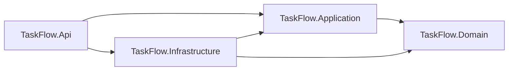
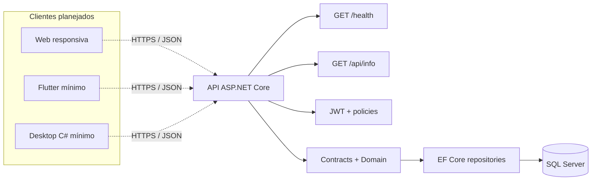

# Arquitetura — TaskFlow

Atualizada em 10/11/2026. A solução adota um monólito modular simples em ASP.NET Core/.NET 10. Uma API compartilhada concentra autenticação, autorização e coordenação das operações. Não há microserviços, CQRS, MediatR ou camadas adicionais.

## Responsabilidades e dependências

| Projeto | Responsabilidade | Dependências de projeto permitidas | Estado atual |
| --- | --- | --- | --- |
| TaskFlow.Domain | Entidades Usuario, Tarefa e HistoricoTarefa, enums e invariantes locais | Nenhuma das outras camadas | Modelo e validações |
| TaskFlow.Application | Contratos de repositório, unidade de trabalho e informações da aplicação | Domain | Contratos e informações |
| TaskFlow.Infrastructure | Persistência SQL Server com EF Core, migrations e repositórios | Application, Domain | Persistência real implementada |
| TaskFlow.Api | Rotas REST, JWT, autorização, contratos HTTP, DI e bootstrap explícito | Application, Infrastructure | Health/info, login e gestão de usuários |
| TaskFlow.Tests | Testes de domínio, middleware HTTP e persistência SQL Server real isolada | Projetos sob teste | Testes automatizados |

As referências da solução expressam a direção das dependências de compilação. A API é o ponto de composição; repositórios e unidade de trabalho são registrados por DI. Não há repositório genérico nem banco em memória para simular persistência.

## Comunicação em execução

`/health` verifica que o processo HTTP responde; não atesta disponibilidade de banco. Em cada requisição com JWT, a API valida assinatura, issuer, audience e expiração e recarrega o usuário do SQL Server para aplicar o perfil atual, não o perfil antigo que esteja no token.

O cliente envia o JWT no cabeçalho Bearer; a API valida identidade e policy antes de executar a rota. Web, mobile e desktop não duplicam autorização e não acessam o banco diretamente.

## Decisões de implementação

- Usar tipos `Guid` para identificadores, enums explícitos e datas UTC. O modelo SQL é detalhado em [modelo de dados](modelo-dados.md).
- Manter a regra de título e validação de enums no domínio. E-mail único e existência de usuários/tarefas dependem de constraints e verificações de persistência.
- `PasswordHash` é gerado/verificado por `PasswordHasher<Usuario>` do ASP.NET Core Identity; sucesso com necessidade de rehash atualiza o valor armazenado. DTOs públicos nunca incluem o hash.
- JWT HMAC-SHA256 usa chave Base64 externa com mínimo de 256 bits, issuer/audience obrigatórios e validade de 60 minutos. Ausência ou chave inválida impede a inicialização; não há valor padrão inseguro.
- Policies ASP.NET Core protegem `/api/users` com o perfil Administrador. Login tem rate limit de 10 tentativas por minuto por IP. `/health` e `/api/info` permanecem públicos.
- O bootstrap do primeiro administrador é comando local `--bootstrap-admin`, somente em Development e somente para `TaskFlowDev`; pede senha sem eco, é idempotente e nunca roda no startup.
- Atualização de usuário usa transação serializável para preservar o último administrador. Não existe endpoint de remoção.
- Concorrência otimista com `rowversion` de oito bytes está mapeada e testada em SQL Server; os endpoints HTTP de tarefa e o conflito HTTP ainda não foram implementados.
- Persistir alterações relevantes de tarefa e histórico na mesma transação. O mecanismo de auditoria será definido antes da implementação SQL complementar, evitando duplicar registros entre aplicação e trigger.
- EF Core migrations são a única fonte oficial do schema. `database/scripts/001_schema.sql` é referência técnica do Dia 1 e não foi executado.
- Carregar configuração não sensível por `appsettings`; connection strings e chave de assinatura vêm de configuração externa/User Secrets, sem valores reais no repositório.
- Expor Swagger apenas em desenvolvimento. A implantação futura deverá configurar HTTPS, observabilidade mínima e verificações de disponibilidade conforme as dependências reais.

## Evolução prevista

As migrations existentes são a única estratégia oficial de evolução do schema. O Dia 3 não alterou schema nem executou migration; fluxo manual de bootstrap no banco de desenvolvimento ainda requer credenciais escolhidas pelo mantenedor.

Docker, Kubernetes, CI/CD e clientes web/mobile/desktop pertencem às próximas sprints; os diretórios reservados não representam infraestrutura implantada. Resultados medidos estão em [ambiente](ambiente.md) e [diário](diario-desenvolvimento.md).
