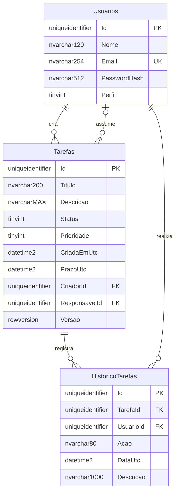

# Modelo de dados — atualizado no Dia 5

Referência: 10/11/2026. O EF Core 10 está integrado à API e ao SQL Server. As migrations oficiais `InitialCreate`, `HardenPersistenceMappings` e `DatabaseDefaults` estão aplicadas em `TaskFlowDev`. O script SQL permanece apenas como referência e não foi aplicado. O Dia 4 adicionou endpoints de criação e consulta de detalhe sem alterar entidades, schema ou migrations.

## Relacionamentos

Cada tarefa possui um criador obrigatório e zero ou um responsável. Um usuário pode criar ou assumir várias tarefas. Cada registro de histórico pertence a uma tarefa e identifica obrigatoriamente o usuário que realizou a alteração. As FKs não possuem exclusão em cascata; a política de inativação de usuários e retenção de histórico será definida antes do CRUD.

## Campos e restrições

Os nomes das entidades são `Usuario`, `Tarefa` e `HistoricoTarefa`; as tabelas são `dbo.Usuarios`, `dbo.Tarefas` e `dbo.HistoricoTarefas`. Textos usam `nvarchar`; limites correspondem a unidades UTF-16, como `string.Length` no C#.

| Tabela/campo | Tipo SQL Server | Regra |
| --- | --- | --- |
| Todas: `Id` | `uniqueidentifier` | PK, não aceita GUID vazio. O domínio recebe um `Guid`; SQL usa `NEWSEQUENTIALID()` como default se omitido. |
| Usuarios: `Nome` | `nvarchar(120)` | Obrigatório e não vazio após remover espaços externos. Domínio usa `Trim()`. |
| Usuarios: `Email` | `nvarchar(254)` | Obrigatório e único, sem espaços externos. Domínio valida formato e normaliza com `Trim().ToLowerInvariant()`. |
| Usuarios: `PasswordHash` | `nvarchar(512)` | Obrigatório e não vazio. Recebe somente um hash produzido pelo futuro serviço de senhas; não é uma senha nem deve aparecer em respostas ou logs. |
| Usuarios: `Perfil` | `tinyint` | `1 = Administrador`; `2 = Funcionario`. Sem default para exigir escolha explícita. |
| Tarefas: `Titulo` | `nvarchar(200)` | Obrigatório, de 1 a 200 unidades após `Trim()` no domínio. |
| Tarefas: `Descricao` | `nvarchar(max)` | Opcional; texto livre. Limites de requisição serão definidos no CRUD. |
| Tarefas: `Status` | `tinyint` | `1 = Pendente` (default), `2 = EmAndamento`, `3 = Concluida`; conversão explícita do enum. |
| Tarefas: `Prioridade` | `tinyint` | `1 = Baixa`, `2 = Media` (default), `3 = Alta`; conversão explícita do enum. |
| Tarefas: `CriadaEmUtc` | `datetime2(7)` | Obrigatória, default `SYSUTCDATETIME()`; leitura remarca `DateTimeKind.Utc`. |
| Tarefas: `PrazoUtc` | `datetime2(7)` | Opcional; domínio exige UTC quando informada. Não há restrição de prazo posterior à criação nesta etapa. |
| Tarefas: `CriadorId` | `uniqueidentifier` | FK obrigatória para Usuarios. |
| Tarefas: `ResponsavelId` | `uniqueidentifier` | FK opcional para Usuarios. |
| Tarefas: `Versao` | `rowversion NOT NULL` | Gerada pelo SQL Server; mapeada ao campo privado `_rowVersion` e à propriedade de leitura `Tarefa.RowVersion`. |
| HistoricoTarefas: `TarefaId` | `uniqueidentifier` | FK obrigatória para Tarefas. |
| HistoricoTarefas: `UsuarioId` | `uniqueidentifier` | FK obrigatória para Usuarios; na criação da tarefa identifica o administrador autenticado. |
| HistoricoTarefas: `Acao` | `nvarchar(80)` | Obrigatória, até 80 unidades; identifica a alteração. |
| HistoricoTarefas: `DataUtc` | `datetime2(7)` | Obrigatória, default `SYSUTCDATETIME()`; leitura remarca `DateTimeKind.Utc`. |
| HistoricoTarefas: `Descricao` | `nvarchar(1000)` | Opcional, até 1.000 unidades; detalhes da alteração. |

O índice `IX_Tarefas_Status_ResponsavelId (Status, ResponsavelId)` atende ao filtro combinado planejado. A consulta somente por responsável deverá ser medida antes de adicionar outro índice. PKs e a unicidade do e-mail também geram seus índices correspondentes.

## Decisões de consistência

- **E-mail único:** a coluna usa `Latin1_General_100_CI_AS`, independente da collation do banco. A entidade normaliza e valida; índice único e collation do SQL impedem duplicidade inclusive sob concorrência e quando há diferença de maiúsculas/minúsculas. `TaskFlowDbContext` converte violações únicas/FK/check em `PersistenceConstraintException` com uma categoria segura, sem embutir detalhes do SQL no texto.
- **UTC:** o domínio exige `DateTimeKind.Utc`. `datetime2` não guarda fuso nem `Kind`; conversores de valor persistem o relógio UTC e reconstituem `DateTimeKind.Utc` na leitura. Defaults usam `SYSUTCDATETIME()`. Não converter valores usando o fuso local do servidor.
- **Concorrência:** `rowversion` é um token binário obrigatório de 8 bytes, gerado pelo SQL Server e configurado como concurrency token. EF usa o campo privado `_rowVersion`; o getter retorna cópia defensiva. A atualização envia a versão original; conflito resulta em `DbUpdateConcurrencyException` e não sobrescreve a primeira atualização. Testes SQL validam cópia, token novo e conflito concorrente com dois `DbContext`s. [Referência oficial do SQL Server](https://learn.microsoft.com/en-us/sql/t-sql/data-types/rowversion-transact-sql?view=sql-server-ver17).
- **Histórico e atomicidade:** as mutações de título, status e prioridade exigem ator/data UTC e retornam um evento apenas quando há mudança. Repetir o mesmo valor retorna `null`. `POST /api/tasks` grava a tarefa e um único evento `CriarTarefa` usando a `IUnitOfWork` e os repositórios existentes. Teste HTTP/SQL Server real provocou falha após salvar o histórico dentro da transação e confirmou que tarefa e histórico foram ambos revertidos.
- **Autorização:** `POST /api/tasks` exige Administrador; identidade autora vem do `sub` validado. `GET /api/tasks/{id}` permite Administrador ou usuário igual ao criador/responsável. A matriz atual está em [escopo.md](escopo.md). SQL não substitui autorização da API.
- **Consulta de histórico:** `GET /api/tasks/{id}/history` retorna `Id`, `TarefaId`, `UsuarioId`, `Acao`, `DataUtc` e `Descricao` por DTO público. O repositório filtra por tarefa, usa `AsNoTracking`, ordena por `DataUtc`/`Id`, executa `COUNT` e pagina no SQL Server (`page` 1-based, default 1; `pageSize` default 20, máximo 100). A API requer vínculo ou perfil Administrador; nenhum endpoint HTTP altera/remove histórico.
- **Validação:** `CHECK` restringe enums, campos obrigatórios e GUIDs vazios; FKs garantem referências existentes. A validação C# de espaços e e-mail é mais completa que as verificações básicas SQL. O banco não reconhece se uma string realmente é um hash seguro; essa responsabilidade pertence ao futuro serviço de senhas. Não há senha de exemplo nem usuário inicial inserido.

## Estratégia única para criar o schema

**EF Core migrations são o único mecanismo oficial de criação e evolução do schema.** `database/scripts/001_schema.sql` é somente referência técnica do Dia 1 e não foi aplicado. Não executar esse script em banco gerenciado por migrations.

`TaskFlowDev` é o banco existente, atualizado por `dotnet ef database update`; não é criado, apagado nem substituído por testes. Antes da última migration foram confirmados zero registros nas três tabelas. A migration corretiva alterou a collation do e-mail e refez `Versao` para `rowversion NOT NULL`; a coluna é gerada novamente pelo SQL Server, sem apagar linhas ou outras colunas. As migrations também incorporaram defaults SQL planejados.

Os testes de persistência usam um banco efêmero `TaskFlowIntegrationTests_<GUID>`, criado e removido pelo fixture em servidor SQL Server real; o catálogo da connection string de teste é forçado para `master` antes de criar a base. O fixture aplica todas as migrations, limpa apenas suas próprias tabelas entre casos e remove somente a base que criou.

Resultado final no Dia 5: 74 aprovados, 0 reprovados e 0 ignorados; 41 testes filtrados por `Category=SqlServer`, incluindo os fluxos HTTP de tarefas/histórico que usam SQL isolado. O fixture cria `TaskFlowIntegrationTests_<GUID>`, aplica migrations existentes e remove somente o banco temporário. A evidência detalhada está no [diário](diario-desenvolvimento.md).

## Objetos programáveis planejados

| Artefato posterior | Finalidade planejada | Verificação necessária |
| --- | --- | --- |
| `002_procedures.sql` | Consulta filtrada de tarefas e operação controlada de alteração, conforme o desenho de persistência aprovado. | Parâmetros, autorização na aplicação, concorrência e erros reais; nenhuma procedure implementada no Dia 1. |
| `003_functions.sql` | Função de cálculo de atraso a partir de prazo, status e instante UTC explícito. | Casos sem prazo, concluídos e limites de data; não criar regra diferente da aplicação. |
| `004_triggers.sql` | Demonstração acadêmica de regra de integridade/auditoria a definir. | Suporte a operações com várias linhas e prevenção de histórico duplicado; escolher um único responsável pelo registro do mesmo evento. |
| `005_transacoes.sql` | Demonstração de atualização de tarefa e inclusão de histórico com commit/rollback. | Falha intermediária deve reverter ambas as alterações; incluir teste de conflito de versão. |

Esses nomes representam o planejamento, não arquivos já presentes. Os artefatos só serão escritos após definir sua integração com a estratégia oficial e a rastreabilidade à disciplina de Programação de Banco de Dados.
