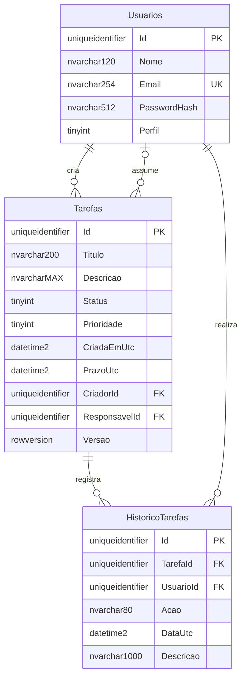

# Modelo de dados — Dia 1

Referência: 09/11/2026. O domínio C# e o esquema SQL Server estão preparados; não há persistência conectada à API, migrations aplicadas, CRUD ou autenticação nesta etapa. O script foi revisado estaticamente e não foi executado em uma instância SQL Server.

## Relacionamentos

Cada tarefa possui um criador obrigatório e zero ou um responsável. Um usuário pode criar ou assumir várias tarefas. Cada registro de histórico pertence a uma tarefa e identifica obrigatoriamente o usuário que realizou a alteração. As FKs não possuem exclusão em cascata; a política de inativação de usuários e retenção de histórico será definida antes do CRUD.

## Campos e restrições

Os nomes das entidades são `Usuario`, `Tarefa` e `HistoricoTarefa`; as tabelas são `dbo.Usuarios`, `dbo.Tarefas` e `dbo.HistoricoTarefas`. Textos usam `nvarchar`; limites correspondem a unidades UTF-16, como `string.Length` no C#.

| Tabela/campo | Tipo SQL Server | Regra |
| --- | --- | --- |
| Todas: `Id` | `uniqueidentifier` | PK, não aceita GUID vazio. C# recebe um `Guid` explícito; SQL tem `NEWSEQUENTIALID()` como default quando o ID é omitido. |
| Usuarios: `Nome` | `nvarchar(120)` | Obrigatório e não vazio após remover espaços externos. Domínio usa `Trim()`. |
| Usuarios: `Email` | `nvarchar(254)` | Obrigatório e único, sem espaços externos. Domínio valida formato e normaliza com `Trim().ToLowerInvariant()`. |
| Usuarios: `PasswordHash` | `nvarchar(512)` | Obrigatório e não vazio. Recebe somente um hash produzido pelo futuro serviço de senhas; não é uma senha nem deve aparecer em respostas ou logs. |
| Usuarios: `Perfil` | `tinyint` | `1 = Administrador`; `2 = Funcionario`. Sem default para exigir escolha explícita. |
| Tarefas: `Titulo` | `nvarchar(200)` | Obrigatório, de 1 a 200 unidades após `Trim()` no domínio. |
| Tarefas: `Descricao` | `nvarchar(max)` | Opcional; texto livre. Limites de requisição serão definidos no CRUD. |
| Tarefas: `Status` | `tinyint` | `1 = Pendente` (default), `2 = EmAndamento`, `3 = Concluida`. |
| Tarefas: `Prioridade` | `tinyint` | `1 = Baixa`, `2 = Media` (default), `3 = Alta`. |
| Tarefas: `CriadaEmUtc` | `datetime2(7)` | Obrigatória, default `SYSUTCDATETIME()`. |
| Tarefas: `PrazoUtc` | `datetime2(7)` | Opcional; domínio exige UTC quando informada. Não há restrição de prazo posterior à criação nesta etapa. |
| Tarefas: `CriadorId` | `uniqueidentifier` | FK obrigatória para Usuarios. |
| Tarefas: `ResponsavelId` | `uniqueidentifier` | FK opcional para Usuarios. |
| Tarefas: `Versao` | `rowversion` | Gerada pelo SQL Server; mapeamento futuro para `Tarefa.RowVersion`. |
| HistoricoTarefas: `TarefaId` | `uniqueidentifier` | FK obrigatória para Tarefas. |
| HistoricoTarefas: `UsuarioId` | `uniqueidentifier` | FK obrigatória para Usuarios. |
| HistoricoTarefas: `Acao` | `nvarchar(80)` | Obrigatória, até 80 unidades; identifica a alteração. |
| HistoricoTarefas: `DataUtc` | `datetime2(7)` | Obrigatória, default `SYSUTCDATETIME()`. |
| HistoricoTarefas: `Descricao` | `nvarchar(1000)` | Opcional, até 1.000 unidades; detalhes da alteração. |

O índice `IX_Tarefas_Status_ResponsavelId (Status, ResponsavelId)` atende ao filtro combinado planejado. A consulta somente por responsável deverá ser medida antes de adicionar outro índice. PKs e a unicidade do e-mail também geram seus índices correspondentes.

## Decisões de consistência

- **E-mail único:** a coluna usa `Latin1_General_100_CI_AS`, independente da collation padrão do banco, para impedir duplicidade por diferença entre maiúsculas e minúsculas. A aplicação normaliza e valida o formato; a constraint `UNIQUE` decide a unicidade inclusive sob concorrência. O domínio isolado não consulta usuários existentes. A camada de aplicação futura deverá converter violação de unicidade em erro de negócio.
- **UTC:** o domínio exige `DateTimeKind.Utc`. `datetime2` não guarda fuso nem `Kind`; a persistência futura deverá gravar UTC e marcar o valor lido como UTC. Os defaults usam `SYSUTCDATETIME()`. Não converter datas usando o fuso local do servidor.
- **Concorrência:** `rowversion` é um token binário de 8 bytes gerado a cada escrita, sem significado de data/hora. No domínio, `RowVersion` é `null` em uma entidade nova ou tem 8 bytes em uma entidade persistida. O futuro mapeamento EF usará `IsRowVersion()`; atualizações deverão comparar a versão lida e tratar conflito, sem sobrescrever silenciosamente. Essa integração ainda não está implementada. [Referência oficial do SQL Server](https://learn.microsoft.com/en-us/sql/t-sql/data-types/rowversion-transact-sql?view=sql-server-ver17).
- **Histórico:** as mutações de título, status e prioridade do domínio exigem ator e data UTC, retornando `HistoricoTarefa` quando há mudança. Repetir o mesmo valor não produz histórico. A camada de aplicação futura persistirá tarefa e histórico na mesma transação e derivará o ator da identidade autenticada. Criação, atribuição, descrição e prazo deverão ganhar o mesmo tratamento quando seus casos de uso forem implementados.
- **Autorização:** perfis são dados de domínio; a existência da coluna não implementa controle de acesso. A matriz de permissões planejadas está em [escopo.md](escopo.md). SQL de referência não aplica autorização por usuário final.
- **Validação:** `CHECK` restringe enums, campos obrigatórios e GUIDs vazios; FKs garantem referências existentes. A validação C# de espaços e e-mail é mais completa que as verificações básicas SQL. O banco não reconhece se uma string realmente é um hash seguro; essa responsabilidade pertence ao futuro serviço de senhas. Não há senha de exemplo nem usuário inicial inserido.

## Estratégia única para criar o schema

`database/scripts/001_schema.sql` é referência técnica do Dia 1. A preferência para o Dia 2 é **EF Core migrations como única estratégia oficial para o schema**. A decisão e o primeiro mapeamento serão registrados antes de provisionar o banco. Não aplicar o SQL e depois uma migration inicial equivalente no mesmo banco. Se houver experimento manual com este script, usar banco de desenvolvimento separado e não reaproveitá-lo como banco inicial das migrations.

O script não cria banco, não remove objetos e não altera tabelas existentes. Ele recusa bancos de sistema, transações já abertas, presença de qualquer uma das três tabelas/objetos com esses nomes e histórico de migrations. Não é idempotente: uma segunda execução termina com erro explícito. Isso evita apresentar um schema preexistente ou parcial como válido. A criação das três tabelas e do índice ocorre em uma única transação com `XACT_ABORT`, `TRY/CATCH` e rollback em erro de execução. Erros de compilação também precisam ser corrigidos antes da execução; o script ainda requer validação real em SQL Server. [Referência oficial sobre XACT_ABORT](https://learn.microsoft.com/en-us/sql/t-sql/statements/set-xact-abort-transact-sql?view=sql-server-ver17).

Quando a execução manual de referência for necessária, selecionar explicitamente uma instância e um banco de desenvolvimento existente e conferir seu nome antes de usar o script. Não há conexão configurada na API neste dia. Para migrations futuras, manter operações e scripts de evolução sob a mesma revisão; objetos programáveis poderão ser adicionados por migrations ou por artefatos versionados executados por elas, evitando duas fontes de criação de tabelas.

## Objetos programáveis planejados

| Artefato posterior | Finalidade planejada | Verificação necessária |
| --- | --- | --- |
| `002_procedures.sql` | Consulta filtrada de tarefas e operação controlada de alteração, conforme o desenho de persistência aprovado. | Parâmetros, autorização na aplicação, concorrência e erros reais; nenhuma procedure implementada no Dia 1. |
| `003_functions.sql` | Função de cálculo de atraso a partir de prazo, status e instante UTC explícito. | Casos sem prazo, concluídos e limites de data; não criar regra diferente da aplicação. |
| `004_triggers.sql` | Demonstração acadêmica de regra de integridade/auditoria a definir. | Suporte a operações com várias linhas e prevenção de histórico duplicado; escolher um único responsável pelo registro do mesmo evento. |
| `005_transacoes.sql` | Demonstração de atualização de tarefa e inclusão de histórico com commit/rollback. | Falha intermediária deve reverter ambas as alterações; incluir teste de conflito de versão. |

Esses nomes representam o planejamento, não arquivos já presentes. Os artefatos só serão escritos após definir sua integração com a estratégia oficial e a rastreabilidade à disciplina de Programação de Banco de Dados.
